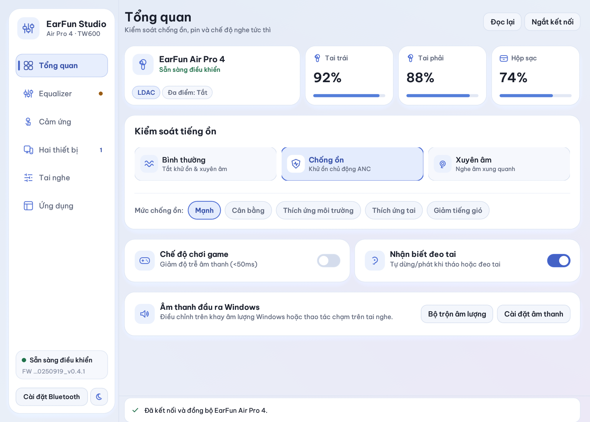
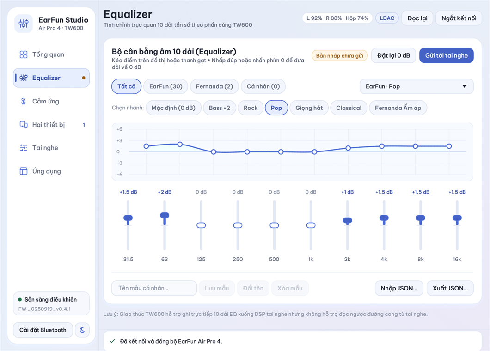
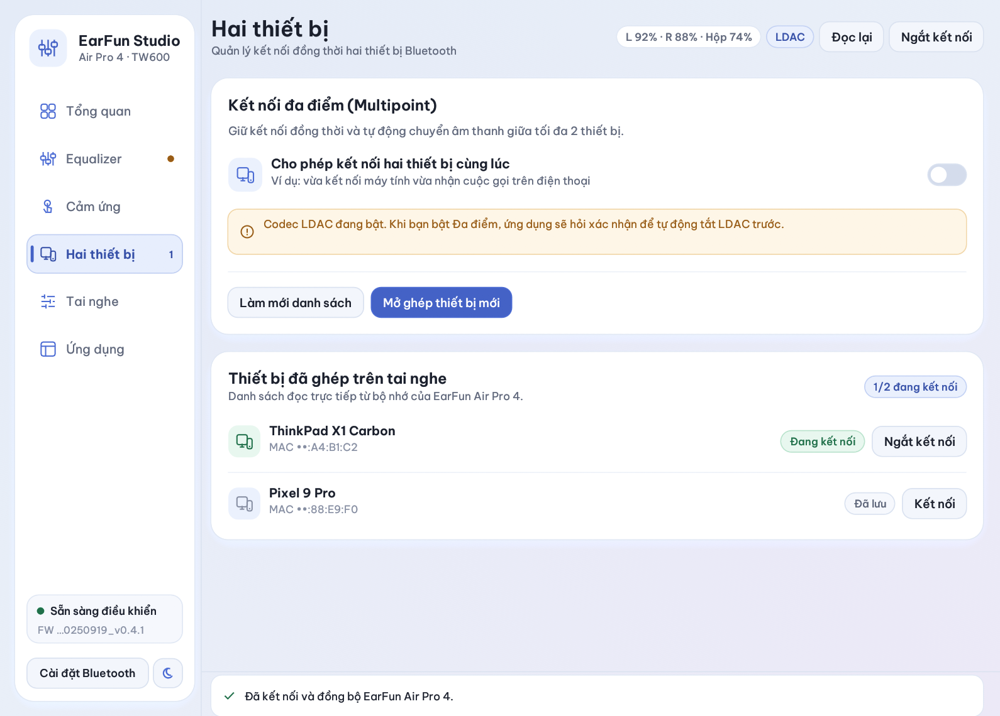
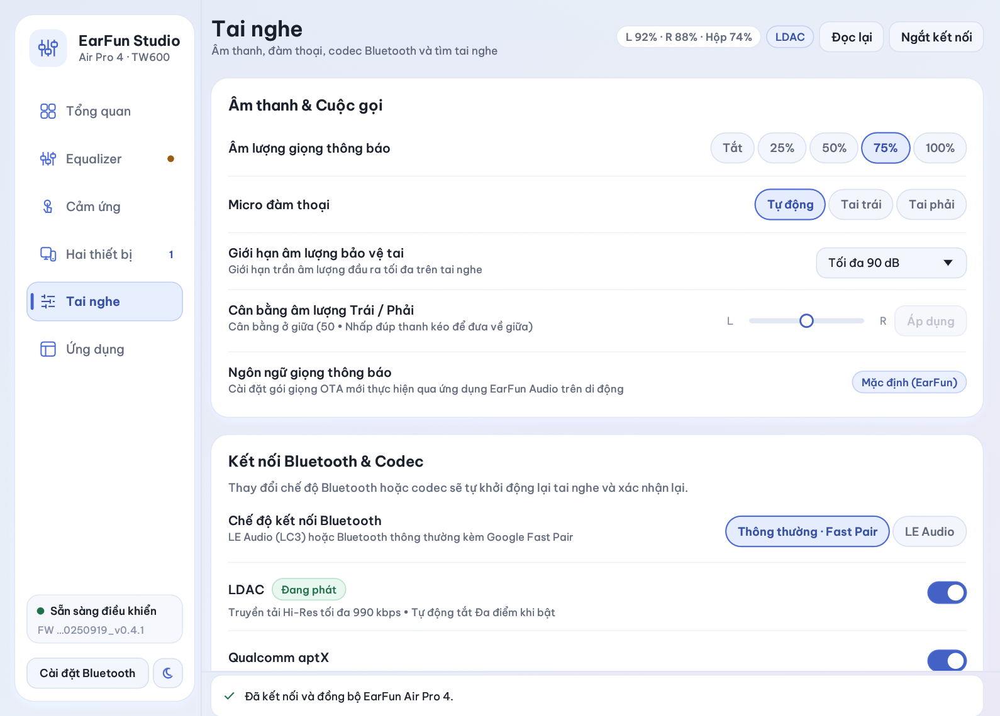
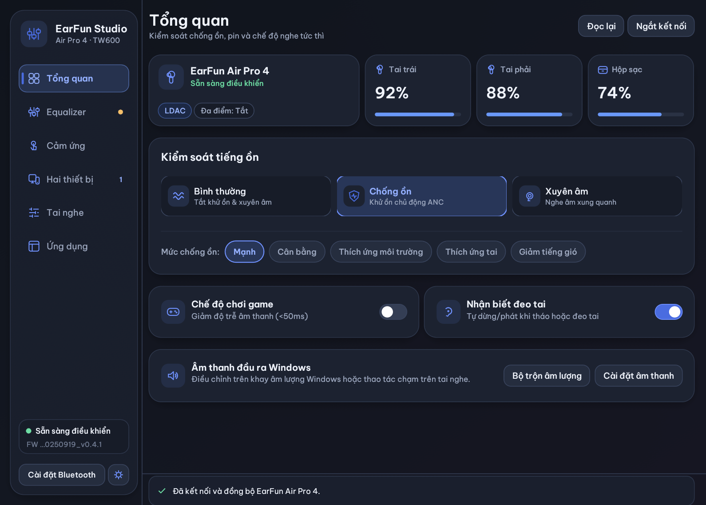

<div align="center">


<h1>EarFun Studio</h1>

<p>A native Rust desktop companion for <strong>EarFun Air Pro 4 (TW600)</strong> earbuds on <strong>Windows 10/11</strong> and <strong>Ubuntu</strong>.</p>

<p>
  <a href="https://github.com/lnb2x/earfun-studio/releases/latest">
    
  </a>
  <a href="docs/README.md">
    
  </a>
</p>

<p>
  <a href="https://github.com/lnb2x/earfun-studio/releases/latest">
    
  </a>
  <a href="https://github.com/lnb2x/earfun-studio/actions/workflows/release.yml">
    
  </a>
  <a href="docs/installation.md#windows-10--11-64-bit">
    
  </a>
  <a href="docs/installation.md#ubuntu-linux-64-bit">
    
  </a>
  <a href="https://www.rust-lang.org">
    
  </a>
  <a href="LICENSE">
    
  </a>
</p>

<p><a href="README.md">Tiếng Việt</a> · <strong>English</strong></p>

</div>

---

## Application Preview

<p align="center">
  <picture>
    <source media="(prefers-color-scheme: dark)" srcset=".github/assets/screenshots/overview-dark.png" />
    
  </picture>
</p>

| Equalizer (10-band TW600) | Multipoint Devices |
| :---: | :---: |
| <picture><source media="(prefers-color-scheme: dark)" srcset=".github/assets/screenshots/equalizer-dark.png" /></picture> | <picture><source media="(prefers-color-scheme: dark)" srcset=".github/assets/screenshots/multipoint-dark.png" /></picture> |
| **Earbuds, Codecs & Find My** | **Dark Mode** |
| <picture><source media="(prefers-color-scheme: dark)" srcset=".github/assets/screenshots/earbuds-dark.png" /></picture> |  |

> Screenshots captured directly from the application in offline preview mode ([`examples/preview.rs`](examples/preview.rs)) using **mocked demo device data**, without physical earbuds connected. Note: the primary in-app interface is in Vietnamese.

## Features

- **Bluetooth LE Reliability**: Built on `btleplug` (WinRT BLE on Windows, BlueZ D-Bus on Ubuntu) with granular lifecycle phases (`ConnectionPhase`), stale adapter recovery, immediate notify-stream drop detection, and exponential auto-reconnect backoff (`8 → 16 → 32 → 60 s`).
- **Active Noise Cancellation & Ambient Sound**: Switch between *Normal*, *ANC* (5 sub-modes), and *Ambient* (2 sub-modes), plus *Game Mode* (`<50 ms`) and *In-Ear Detection*.
- **10-Band Equalizer**: Nonlinear 21-step TW600 gain table (`-6` to `+6 dB`), **30 EarFun + 2 Fernanda presets** extracted from APK `20.1.61`, interactive Bezier curve and center-origin faders, personal preset management, and JSON import/export (`earfun-studio.eq`).
- **Touch Controls**: Configure 8 touch actions (single/double/triple tap and hold for L/R) filtered strictly to TW600 firmware capabilities, plus independent left/right touch locks.
- **Multipoint Management**: Inspect paired devices stored on the headset, connect/disconnect, trigger pairing mode, and resolve bidirectional LDAC ↔ Multipoint dependencies through explicit confirmation workflows.
- **Codecs & Bluetooth Mode**: Toggle `LDAC`, `aptX`, `aptX Adaptive`, `aptX Lossless` and switch between *Standard Bluetooth · Google Fast Pair* and *LE Audio* with automated reconnect and state readback verification.
- **Audio & Diagnostics**: Prompt volume, call microphone selection, hearing protection limit (`50–90 dB`), L/R balance, 10-second Find My Earbuds (with immediate non-blocking stop), Factory Reset, Ubuntu PipeWire/WirePlumber sink volume control, and MAC-redacted BLE packet logs.

## Download & Installation

Get prebuilt packages from [GitHub Releases](https://github.com/lnb2x/earfun-studio/releases/latest). Full steps and checksum verification instructions are in [docs/installation.md](docs/installation.md).

- **Windows 10/11 (`x86_64`)**: `EarFunStudio-Windows-<version>-x86_64.exe` (standalone) or `.zip` (includes docs and licenses). Unsigned binary; verify `SHA256SUMS.txt` if SmartScreen prompts.
- **Ubuntu 22.04+ (`x86_64` / `amd64`)**: `earfun-studio_<version>_amd64.deb` (`sudo apt install ./earfun-studio_<version>_amd64.deb`) or portable `.tar.gz` with [`install.sh`](install.sh).

## Compatibility

- **CI-verified**: Windows 10/11 `x86_64` and Ubuntu 22.04 `x86_64` builds, unit/integration tests with mocked BLE, and headless 12-check Light/Dark smoke tests.
- **Hardware verification**: Protocol matches EarFun Audio APK `20.1.61` and prior physical observations on firmware `TW600-3091_20250919_v0.4.1`; live Bluetooth hardware behavior in v1.5.1 is not exercised by CI runners.
- **ARM64**: Not built in release workflows.

## Quick Start

1. Download the release package for Windows or Ubuntu and verify its SHA256 checksum.
2. Install or extract the executable.
3. Pair **EarFun Air Pro 4** in your OS Bluetooth settings with both earbuds out of the case.
4. Launch EarFun Studio (auto-connect searches for your headset; use **Quét BLE** if selecting manually among multiple headsets).
5. Adjust ANC, EQ (click **Gửi tới tai nghe** to write to DSP), touch controls, or codecs.

## Development & Architecture

```sh
cargo fmt --all -- --check
cargo clippy --locked --all-targets -- -D warnings
cargo test --locked
EARFUN_HEADLESS=1 cargo run --locked -- --smoke-test
```

See [docs/development.md](docs/development.md) for system dependencies and packaging, and [docs/architecture.md](docs/architecture.md) for the BLE state machine and hardware-safety invariants (no `getter 113` in `QUERIES`, no automatic EQ writes, Linux `close_session` preserves A2DP audio).

## Community

- [Issues](https://github.com/lnb2x/earfun-studio/issues) · [Pull Requests](https://github.com/lnb2x/earfun-studio/pulls)
- [Contributing](CONTRIBUTING.md) · [Security Policy](SECURITY.md) · [Code of Conduct](CODE_OF_CONDUCT.md)
- Licensed under the [MIT License](LICENSE). Bundled *Be Vietnam Pro* fonts are licensed under [SIL OFL 1.1](assets/fonts/OFL.txt).
