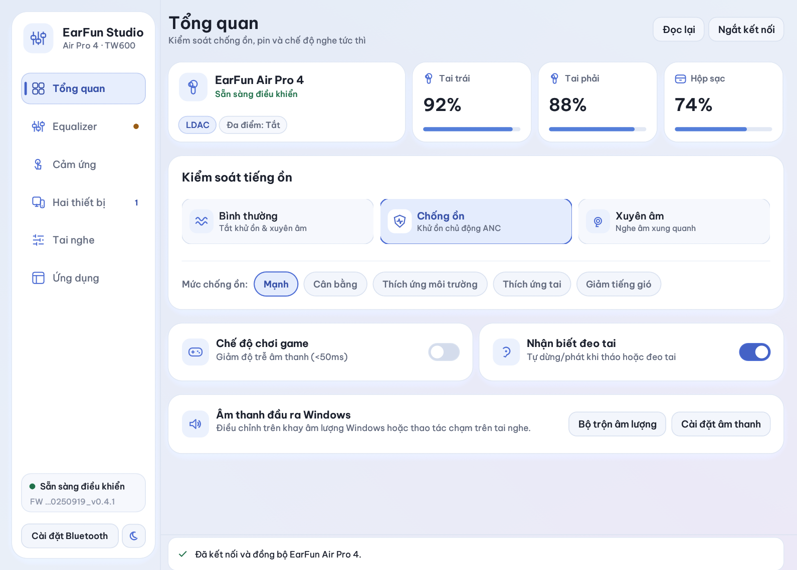
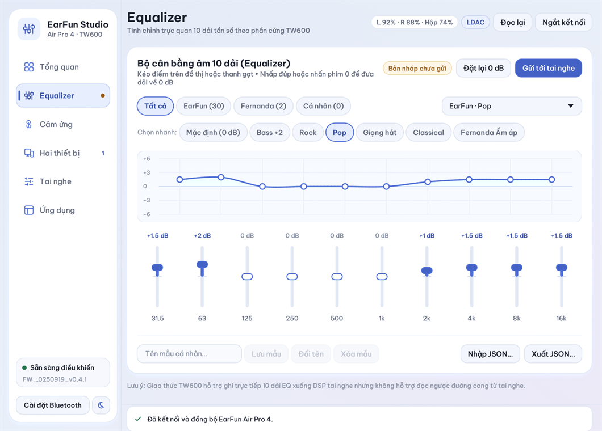
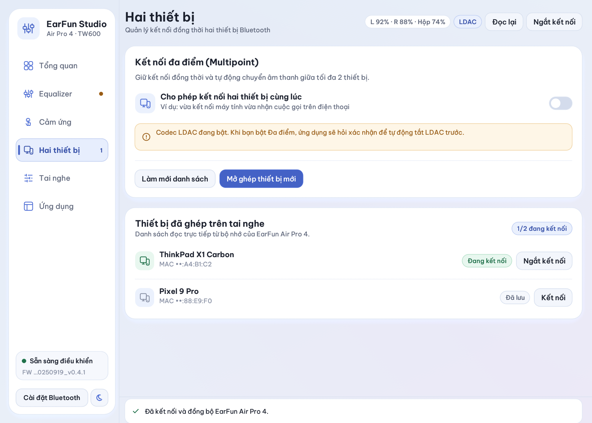
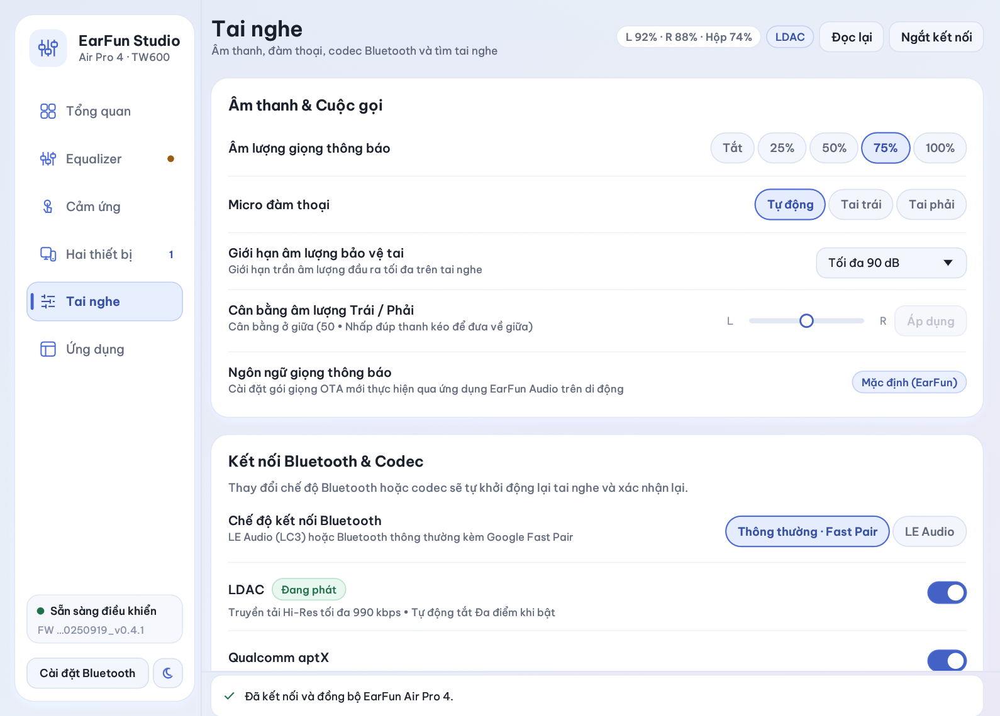
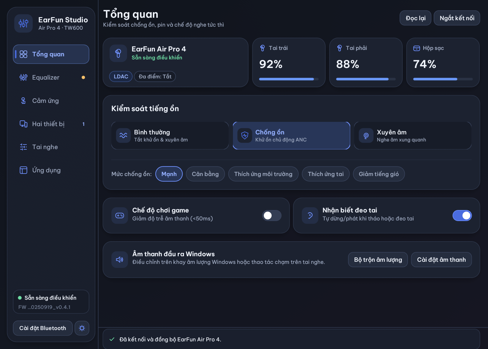
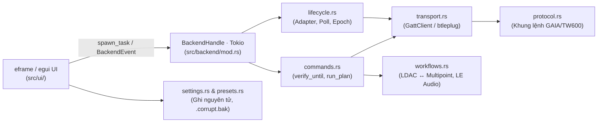

<div align="center">


<h1>EarFun Studio</h1>

<p>Ứng dụng desktop điều khiển tai nghe <strong>EarFun Air Pro 4 (TW600)</strong> trên <strong>Windows 10/11</strong> và <strong>Ubuntu</strong>.</p>

<p>
  <a href="https://github.com/lnb2x/earfun-studio/releases/latest">
    
  </a>
  <a href="docs/README.md">
    
  </a>
</p>

<p>
  <a href="https://github.com/lnb2x/earfun-studio/releases/latest">
    
  </a>
  <a href="https://github.com/lnb2x/earfun-studio/actions/workflows/release.yml">
    
  </a>
  <a href="docs/installation.md#windows-10--11-64-bit">
    
  </a>
  <a href="docs/installation.md#ubuntu-linux-64-bit">
    
  </a>
  <a href="https://www.rust-lang.org">
    
  </a>
  <a href="LICENSE">
    
  </a>
</p>

<p><strong>Tiếng Việt</strong> · <a href="README.en.md">English</a></p>

</div>

---

## Xem trước giao diện

<p align="center">
  <picture>
    <source media="(prefers-color-scheme: dark)" srcset=".github/assets/screenshots/overview-dark.png" />
    
  </picture>
</p>

| Equalizer (10 dải TW600) | Hai thiết bị (Multipoint) |
| :---: | :---: |
| <picture><source media="(prefers-color-scheme: dark)" srcset=".github/assets/screenshots/equalizer-dark.png" /></picture> | <picture><source media="(prefers-color-scheme: dark)" srcset=".github/assets/screenshots/multipoint-dark.png" /></picture> |
| **Tai nghe & Codec Bluetooth** | **Giao diện Tối (Dark Mode)** |
| <picture><source media="(prefers-color-scheme: dark)" srcset=".github/assets/screenshots/earbuds-dark.png" /></picture> |  |

> Ảnh chụp từ chính ứng dụng ở chế độ xem trước ngoại tuyến ([`examples/preview.rs`](examples/preview.rs)) với **dữ liệu thiết bị minh họa**, không kết nối tai nghe thật.

## Tính năng

- **Kết nối Bluetooth LE**: Dùng `btleplug` (WinRT BLE trên Windows và BlueZ D-Bus trên Ubuntu) với máy trạng thái kết nối chi tiết (`ConnectionPhase`), tự làm mới bộ thu `Adapter`, phát hiện rớt kênh notify tức thì và tự kết nối lại theo độ trễ tăng dần (`8 → 16 → 32 → 60 giây`).
- **Chống ồn chủ động (ANC) & Xuyên âm**: Chuyển nhanh 3 nhóm (*Bình thường*, *Chống ồn ANC* với 5 mức, *Xuyên âm* với 2 mức), bật/tắt *Chế độ chơi game* (`<50ms`) và *Nhận biết đeo tai*.
- **Equalizer 10 dải**: Tinh chỉnh từ `−6` đến `+6 dB` theo đúng bảng gain 21 mức phi tuyến của TW600; tích hợp **30 mẫu EarFun + 2 mẫu Fernanda** từ APK `20.1.61`; kéo điểm trên đồ thị Bezier hoặc thanh gạt tâm `0 dB`; lưu/đổi tên/xóa mẫu cá nhân và nhập/xuất JSON (`earfun-studio.eq`).
- **Điều khiển cảm ứng**: Tùy chỉnh 8 thao tác chạm (*Chạm một/hai/ba lần* và *Nhấn giữ* cho tai Trái/Phải), tự lọc đúng danh sách thao tác được hỗ trợ theo loại chạm và phiên bản firmware, cùng công tắc khóa cảm ứng riêng từng tai.
- **Hai thiết bị (Multipoint)**: Xem danh sách thiết bị đã ghép trên tai nghe, kết nối/ngắt, mở chế độ ghép thiết bị mới, và tự xử lý phụ thuộc hai chiều với codec LDAC qua hộp thoại xác nhận.
- **Quản lý Codec & Chế độ Bluetooth**: Bật/tắt `LDAC`, `aptX`, `aptX Adaptive`, `aptX Lossless` và chuyển đổi giữa *Bluetooth thông thường · Google Fast Pair* với *LE Audio*, kèm tự nối lại và đọc lại xác nhận trạng thái.
- **Thiết lập tai nghe & Âm lượng hệ thống**: Âm lượng giọng thông báo, chọn micro đàm thoại, giới hạn trần âm lượng bảo vệ thính giác (`50–90 dB`), cân bằng Trái/Phải, *Tìm tai nghe* (tự dừng sau 10 giây, nút *Dừng ngay* gửi lệnh dừng không bị nghẽn sau thao tác khác), *Khôi phục cài đặt gốc*, và điều khiển âm lượng sink PipeWire/WirePlumber trên Ubuntu.
- **Đa nền tảng & Tiện ích**: Một tệp thực thi duy nhất viết bằng `eframe`/`egui`; giao diện **Sáng / Tối / Hệ thống** (`Alt+T`), nhúng phông tiếng Việt *Be Vietnam Pro*, phím tắt `Alt+1..6`, `F5`, `Enter/Esc`, và nhật ký BLE tự động ẩn địa chỉ MAC khi sao chép hoặc xuất tệp.

## Tải về và Cài đặt

Tải các gói phát hành tại trang [GitHub Releases](https://github.com/lnb2x/earfun-studio/releases/latest) (hoặc xem hướng dẫn chi tiết và kiểm tra checksum trong [Tài liệu cài đặt](docs/installation.md)).

| Hệ điều hành | Gói phát hành | Ghi chú |
|---|---|---|
| **Windows 10 / 11 (x86_64)** | `EarFunStudio-Windows-<phiên-bản>-x86_64.exe` | Tệp thực thi đơn lẻ, chạy trực tiếp |
| **Windows 10 / 11 (x86_64)** | `EarFunStudio-Windows-<phiên-bản>-x86_64.zip` | Gồm `EarFunStudio.exe`, `README.md`, `LICENSE`, `OFL-BeVietnamPro.txt`, `docs/` |
| **Ubuntu 22.04+ (amd64)** | `earfun-studio_<phiên-bản>_amd64.deb` | Cài qua `sudo apt install ./earfun-studio_<phiên-bản>_amd64.deb` |
| **Ubuntu 22.04+ (x86_64)** | `EarFunStudio-Ubuntu-<phiên-bản>-x86_64.tar.gz` | Gói portable kèm [`install.sh`](install.sh), [`run.sh`](run.sh), [`uninstall.sh`](uninstall.sh) |

> [!NOTE]
> Tệp `.exe` trên Windows hiện chưa được ký số (code signing), nên Windows Defender SmartScreen có thể hiển thị cảnh báo xác nhận lần chạy đầu. Luôn đối chiếu mã băm với `SHA256SUMS.txt` đính kèm mỗi bản phát hành.

## Tương thích

| Thành phần | Phạm vi | Trạng thái kiểm chứng |
|---|---|---|
| **Windows 10 / 11 (`x86_64`)** | Biên dịch, unit test, headless smoke test `--smoke-test` | **Đã chạy trên CI**; kết nối WinRT BLE phần cứng cần kiểm chứng trên máy thật |
| **Ubuntu (`x86_64`, `amd64`)** | Biên dịch trên Ubuntu 22.04, unit test, cài gói `.deb`, smoke test | **Đã chạy trên CI**; BlueZ BLE & PipeWire/WirePlumber cần kiểm chứng trên máy thật |
| **ARM64 (Windows / Linux)** | Chưa có bản dựng sẵn | Chưa hỗ trợ đóng gói phát hành |
| **Tai nghe** | **EarFun Air Pro 4 (`TW600`)** | Giao thức đối chiếu APK `20.1.61`; firmware tham chiếu đã đọc trước đó: `TW600-3091_20250919_v0.4.1` |
| **Dual boot Windows ↔ Ubuntu** | Dùng chung bộ thu Bluetooth giữa 2 hệ điều hành | Cần đồng bộ khóa ghép đôi BLE; xem [Hướng dẫn xử lý sự cố Bluetooth](docs/bluetooth-troubleshooting.md) |

## Bắt đầu nhanh

1. **Tải về** gói phù hợp từ [GitHub Releases](https://github.com/lnb2x/earfun-studio/releases/latest) và đối chiếu mã SHA256.
2. **Cài đặt** (mở `.exe` trên Windows, hoặc `sudo apt install ./earfun-studio_<phiên-bản>_amd64.deb` trên Ubuntu).
3. **Ghép đôi tai nghe**: lấy cả hai tai nghe ra khỏi hộp sạc và ghép đôi **EarFun Air Pro 4** trong phần cài đặt Bluetooth của hệ điều hành.
4. **Mở EarFun Studio**: ứng dụng tự quét và kết nối tới tai nghe đã nhớ; nếu có nhiều thiết bị, bấm **Quét BLE** và chọn đúng tai nghe một lần.
5. **Tùy chỉnh**: chỉnh chống ồn, EQ 10 dải (bấm **Gửi tới tai nghe** để ghi xuống DSP), thao tác cảm ứng hoặc codec theo nhu cầu.

## Phát triển & Kiểm thử

Yêu cầu Rust toolchain `1.99.1` (hoặc stable mới hơn) và trên Ubuntu cần các thư viện phát triển hệ thống (chi tiết trong [Hướng dẫn phát triển](docs/development.md)):

```sh
# 1. Kiểm tra định dạng & cảnh báo tĩnh Clippy
cargo fmt --all -- --check
cargo clippy --locked --all-targets -- -D warnings

# 2. Chạy toàn bộ kiểm thử tự động (giao thức, backend giả lập, lưu trữ, giao diện)
cargo test --locked

# 3. Kiểm tra bố cục 6 trang Sáng/Tối ở chế độ headless
EARFUN_HEADLESS=1 cargo run --locked -- --smoke-test
```

Đóng gói phát hành cục bộ: `./packaging/build.sh` (Ubuntu) hoặc `./packaging/build-windows.ps1` (Windows PowerShell).

## Kiến trúc



Xem chi tiết máy trạng thái BLE, khóa đồng thời (`op_lock` / `wire_lock`) và bất biến phần cứng tại [Kiến trúc kỹ thuật](docs/architecture.md).

## Giới hạn & An toàn phần cứng

- **Không đọc ngược đường cong EQ**: Giao thức TW600 hỗ trợ ghi 10 dải EQ xuống DSP nhưng chưa hỗ trợ đọc lại đường cong đang lưu trên tai nghe.
- **Không giả lập tính năng phụ thuộc OTA/phần cứng chưa kiểm chứng**: Cập nhật Firmware OTA, cài gói giọng thông báo OTA mới, đo thính lực *Adaptive EQ* và nguồn phát *Auracast (GBSS)* không được giả lập; vui lòng dùng ứng dụng **EarFun Audio** trên điện thoại cho các tác vụ này.
- **Bảo vệ người dùng & âm thanh**: Các thao tác khởi động lại tai nghe, phát âm báo lớn (*Tìm tai nghe*) hay *Khôi phục cài đặt gốc* luôn qua hộp thoại xác nhận; trên Linux, đóng ứng dụng chỉ hủy đăng ký GATT notify để tránh ngắt luồng nhạc A2DP.

Chi tiết xem thêm tại [Đối chiếu tính năng APK 20.1.61](docs/apk-feature-audit.md) và [Xử lý sự cố Bluetooth](docs/bluetooth-troubleshooting.md).

## Cộng đồng

- [Báo lỗi](https://github.com/lnb2x/earfun-studio/issues/new/choose) · [Pull Requests](https://github.com/lnb2x/earfun-studio/pulls)
- [Hướng dẫn đóng góp](CONTRIBUTING.md) · [Chính sách bảo mật](SECURITY.md) · [Quy tắc ứng xử](CODE_OF_CONDUCT.md)
- Mã nguồn phát hành theo giấy phép [MIT](LICENSE). Phông chữ *Be Vietnam Pro* nhúng trong ứng dụng theo giấy phép [SIL OFL 1.1](assets/fonts/OFL.txt).
