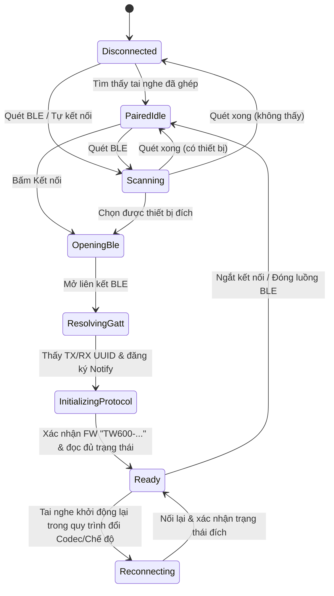

# Kiến trúc Kỹ thuật EarFun Studio

Tài liệu này mô tả kiến trúc phần mềm, luồng dữ liệu bất đồng bộ, máy trạng thái kết nối Bluetooth LE, ma trận tính năng TW600 và các quy tắc an toàn phần cứng của **EarFun Studio**.

## 1. Phân lớp Mô-đun

| Mô-đun | Trách nhiệm chính | Phụ thuộc nội bộ |
|---|---|---|
| `src/protocol.rs` | Mã hóa/giải mã khung lệnh GAIA/TW600, bảng gain EQ 21 mức, tách mã phiên bản firmware, lọc thao tác cảm ứng theo APK `20.1.61`, ẩn địa chỉ MAC nhạy cảm | Độc lập (thuần hàm) |
| `src/presets.rs` | Quản lý danh mục 32 preset chính hãng (`OnceLock`), làm sạch tên preset, nhập/xuất định dạng `earfun-studio.eq` phiên bản 1 | `protocol` |
| `src/workflows.rs` | Lập kế hoạch chuyển đổi trạng thái có phụ thuộc (xung đột `LDAC` ↔ `Multipoint`, quy trình khởi động lại `LE Audio` / `In-Ear Detection`) | `protocol` |
| `src/settings.rs` | Lưu trữ cấu hình người dùng (`auto_connect`, `last_mac`, `eq`, `presets`, `theme`), sao lưu `.corrupt.bak` khi lỗi cú pháp, ghi tệp nguyên tử đa nền tảng | `presets` |
| `src/audio.rs` | Điều khiển âm lượng sink Bluetooth qua PipeWire/WirePlumber bất đồng bộ (Ubuntu) và mở cài đặt hệ thống qua URI đã xác thực (Windows & Ubuntu) | Độc lập |
| `src/backend/mod.rs` | Định nghĩa `BackendCore`, `BackendHandle`, `ConnectionPhase`, `BackendEvent` và điều phối Tokio runtime (2 worker threads) | `protocol`, `audio` |
| `src/backend/transport.rs` | Trait `GattClient`, triển khai `BtleplugClient`, ghép cặp `request`/`notify`, bộ thu thập đa gói cho `cmd 44` (`phones_internal`) | `backend`, `protocol` |
| `src/backend/commands.rs` | Các thao tác đọc/ghi có xác nhận đọc lại đa trường (`verify_until`), ghi EQ 10 gói, điều khiển Tìm tai nghe 10 giây, chạy `Plan` có phục hồi | `backend`, `protocol`, `workflows` |
| `src/backend/lifecycle.rs` | Kiểm tra `Adapter` `PoweredOn`, quét thiết bị, bắt tay firmware `TW600-…`, luồng poll định kỳ 10 giây và dọn dẹp phiên an toàn | `backend`, `protocol` |
| `src/ui/` | Hệ thống thiết kế Sáng/Tối (`theme.rs`), thành phần chống tràn (`widgets.rs`), biểu tượng vector (`icons.rs`), thanh điều hướng (`header.rs`) và 6 trang chức năng (`pages/*.rs`) | `backend`, `protocol`, `presets`, `settings`, `workflows`, `audio` |

## 2. Máy Trạng thái Kết nối Bluetooth LE

- **Tách biệt khóa đồng bộ**:
  - `op_lock` (`tokio::sync::Mutex`): Tuần tự hóa các thao tác cấp người dùng (`connect`, `scan`, `query`, `set_*`, `run_plan`).
  - `wire_lock` (`tokio::sync::Mutex`): Bảo vệ từng cặp ghi GATT và chờ phản hồi trên đường truyền.
  - `std::sync::Mutex` nội bộ luôn đi qua hàm `lock()` chống nhiễm độc (`PoisonError::into_inner`) và không bao giờ giữ qua điểm `.await`.

## 3. Chính sách An toàn Phần cứng TW600

1. **Xác thực bắt buộc**: Không bao giờ gửi lệnh ghi cài đặt trước khi `cmd 9` trả về chuỗi bắt đầu bằng `TW600-`.
2. **Bảo toàn kết nối âm thanh Linux**: Trên Ubuntu/BlueZ, đóng ứng dụng chỉ hủy đăng ký GATT notify (`unsubscribe`), tuyệt đối không gọi `peripheral.disconnect()` để không làm rớt luồng nhạc A2DP.
3. **Không suy diễn giao thức**:
   - Không tự gửi `getter 113` khi khởi tạo (đã xác nhận gây timeout 4 giây trên firmware `TW600-3091_20250919_v0.4.1`) và không gửi `setter 112` thay cho luồng cài gói giọng OTA.
   - Không giả lập công tắc cho *Firmware OTA*, *Adaptive EQ* hay *Auracast (GBSS)*.
   - Không tự động chạy *Khôi phục cài đặt gốc (`cmd 54`)* hay *Tìm tai nghe (`cmd 50`)* nếu chưa có xác nhận tường minh từ hộp thoại người dùng.
